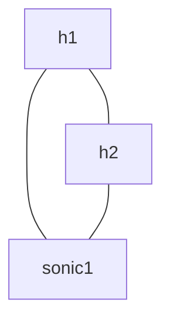

# ЛР 1. Containerlab и SONiC

## Подготовка

Нужны Linux x86-64, Docker, Containerlab и команда `envsubst` из пакета
`gettext-base`. Если образы `sonic-course:202511` и `lab-tools:1.0` уже есть,
переходите к запуску. [Установка Containerlab](https://containerlab.dev/install/)

Сохраните образ как `docker-sonic-vs-202511.gz` в корне проекта.
Команды сборки запускайте из этой папки. [Скачать сборку SONiC VS 1278069](https://sonic-build.azurewebsites.net/api/sonic/artifacts?branchName=202511&platform=vs&target=target/docker-sonic-vs.gz&buildId=1278069)

```bash
echo '8103c170ac1ab180ce7c63994b6b65a7402672f65be484c0f282f5d5d91d805c  docker-sonic-vs-202511.gz' | sha256sum -c
docker load -i docker-sonic-vs-202511.gz
docker tag docker-sonic-vs:latest docker-sonic-vs:202511
docker build -t sonic-course:202511 images/sonic-course
docker build -t lab-tools:1.0 images/lab-tools
```

## Схема стенда



| Порт в топологии | Порт в SONiC | Линии | Псевдоним |
| --- | --- | --- | --- |
| eth1 | Ethernet0 | 25,26,27,28 | fortyGigE0/0 |
| eth2 | Ethernet4 | 29,30,31,32 | fortyGigE0/4 |

Хосты соединены напрямую через `eth2` в сети `10.32.1.0/24`.
Интерфейсы управления `eth0` находятся в сети `10.101.32.0/24`.

## Запуск

Начните из корня проекта. Если Containerlab требует права администратора, используйте
`sudo --preserve-env=STUDENT,N containerlab`.

```bash
export STUDENT=umralieva N=32
cd lab1
containerlab deploy -t lab1.clab.yml
containerlab inspect -t lab1.clab.yml
containerlab graph --offline --mermaid -t lab1.clab.yml
docker exec "clab-$STUDENT-l1-h1" ping -c 3 "10.$N.1.2"
```

Дождитесь запуска SONiC. Войдите в контейнер первой командой, затем проверьте порт.

```bash
docker exec -it "clab-$STUDENT-l1-sonic1" bash
cat /etc/sonic/sonic_version.yml
supervisorctl status
show interfaces status Ethernet0,Ethernet4
show interfaces alias
redis-cli -n 4 hgetall 'PORT|Ethernet0'
sudo config interface startup Ethernet0
redis-cli -n 4 hget 'PORT|Ethernet0' admin_status
redis-cli -n 0 hgetall PORT_TABLE:Ethernet0
redis-cli -n 1 keys 'ASIC_STATE:SAI_OBJECT_TYPE_PORT:*' | wc -l
show interfaces status Ethernet0
exit
```

Удалите стенд командой `containerlab destroy -t lab1.clab.yml --cleanup`
и запустите его снова. В колонке `Admin` у `Ethernet0` снова будет `down`.

## Ответы на вопросы

- SONiC VS использует ядро хоста. MikroTik CHR загружает свое ядро в виртуальной машине и использует KVM.
- На физическом коммутаторе `orchagent` и `portsyncd` работают в SWSS, `syncd` работает в своем контейнере. Службы `zebra`, `bgpd` и `fpmsyncd` находятся в контейнере BGP. В ЛР 1 служба `bgpd` остановлена, поскольку BGP-соседство не настраивали.
- Номера портов идут с шагом четыре, потому что каждый порт занимает четыре линии.
- CONFIG_DB хранит настройки, APPL_DB передает их `orchagent`, ASIC_DB хранит объекты SAI, а STATE_DB показывает текущее состояние. `portmgrd` записывает настройки порта в APPL_DB, `orchagent` создает объекты в ASIC_DB.
- При повторном запуске Containerlab берет исходные настройки из образа и файла топологии. Чтобы порт включался при каждом запуске, добавьте команду включения в конфигурацию запуска.
