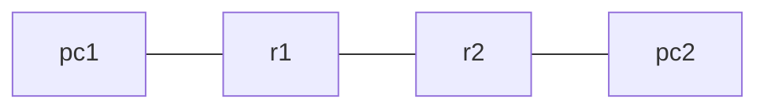
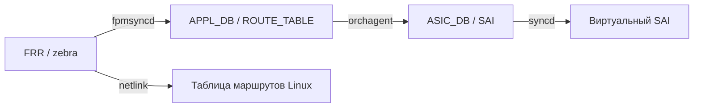

# ЛР 2. Статическая маршрутизация и eBGP



| Узел | Ethernet0 / eth1 | Ethernet4 | Loopback0 | AS или шлюз |
| --- | --- | --- | --- | --- |
| pc1 | 10.32.1.10/24 | - | - | 10.32.1.1 |
| r1 | 10.32.1.1/24 | 10.32.0.0/31 | 10.32.255.1/32 | 65032 |
| r2 | 10.32.2.1/24 | 10.32.0.1/31 | 10.32.255.2/32 | 65132 |
| pc2 | 10.32.2.10/24 | - | - | 10.32.2.1 |

Интерфейсы управления `eth0` находятся в сети `10.102.32.0/24`.

## Подготовка

Нужны Linux x86-64, Docker, Containerlab и команда `envsubst` из пакета
`gettext-base`. Если образы `sonic-course:202511` и `lab-tools:1.0` уже есть,
переходите к запуску. [Установка Containerlab](https://containerlab.dev/install/)

Сохраните образ как `docker-sonic-vs-202511.gz` в корне проекта.
Команды сборки запускайте из этой папки. [Скачать сборку SONiC VS 1278069](https://sonic-build.azurewebsites.net/api/sonic/artifacts?branchName=202511&platform=vs&target=target/docker-sonic-vs.gz&buildId=1278069)

```bash
echo '8103c170ac1ab180ce7c63994b6b65a7402672f65be484c0f282f5d5d91d805c  docker-sonic-vs-202511.gz' | sha256sum -c
docker load -i docker-sonic-vs-202511.gz
docker tag docker-sonic-vs:latest docker-sonic-vs:202511
docker build -t sonic-course:202511 images/sonic-course
docker build -t lab-tools:1.0 images/lab-tools
```

## Запуск

Начните из корня проекта. Если Containerlab требует права администратора, используйте
`sudo --preserve-env=STUDENT,N containerlab`.

```bash
export STUDENT=umralieva N=32
cd lab2
containerlab deploy -t lab2.clab.yml
bash ./apply.sh
docker exec "clab-$STUDENT-l2-r1" vtysh -c "show bgp summary"
```

Повторяйте `show bgp summary`, пока в колонке `State/PfxRcd` не появится
число 2. Затем проверьте связь.

```bash
docker exec "clab-$STUDENT-l2-pc1" ping -c 3 "10.$N.2.10"
docker exec "clab-$STUDENT-l2-pc1" traceroute -n "10.$N.2.10"
```

Для повторного запуска удалите стенд командой
`containerlab destroy -t lab2.clab.yml --cleanup`. Повторите `deploy` и `bash ./apply.sh`.

## Как маршрут попадает в таблицы SONiC и Linux


